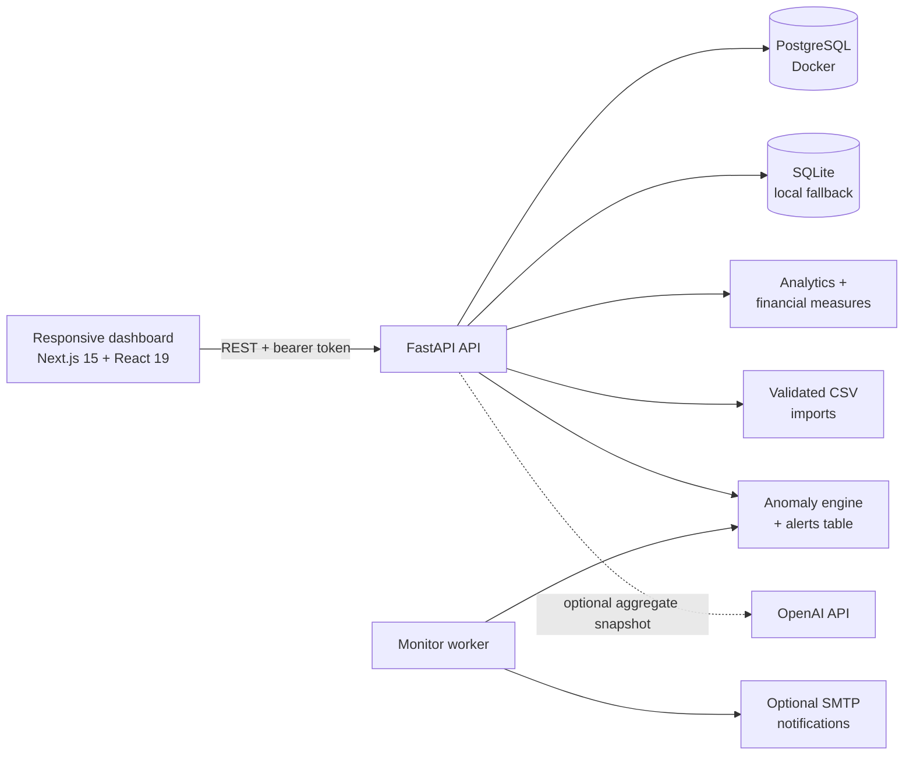

# ProfitLens

## E-commerce profitability and returns intelligence


ProfitLens turns order, product, and returns data into the metrics an e-commerce operator actually needs: **what sold, what made money, what was returned, and what needs attention next**.

It is a full-stack analytics platform with a responsive Next.js dashboard, FastAPI backend, PostgreSQL persistence, private workspaces, validated CSV imports, anomaly detection, scheduled monitoring, and an optional AI assistant.

<p align="center">
  <strong>Understand revenue. Find leakage. Protect contribution profit.</strong>
</p>

> **Project status:** Backend validation is complete with 10 passing tests. Frontend production build, Docker integration, SMTP delivery, and live OpenAI integration still require local verification. See [Validation status](#validation-status).

## Contents

- [Why ProfitLens](#why-profitlens)
- [Product capabilities](#product-capabilities)
- [Quickstart](#quickstart)
- [Explore the dashboard](#explore-the-dashboard)
- [Architecture](#architecture)
- [Import data](#import-data)
- [Financial model](#financial-model)
- [Alert engine](#alert-engine)
- [AI assistant](#ai-assistant)
- [Development](#development)
- [Repository layout](#repository-layout)
- [Validation status](#validation-status)
- [Security and production notes](#security-and-production-notes)

## Why ProfitLens

Revenue dashboards can hide the economics of a store. ProfitLens brings the full contribution picture together by accounting for:

- Refunds and return shipping
- Product cost of goods sold
- Outbound shipping
- Marketplace and platform fees
- Product-level return risk
- Inventory levels and low-stock signals

The result is a practical operator view rather than a vanity metrics dashboard.

## Product capabilities

| Capability | What it provides |
| --- | --- |
| **Executive overview** | Revenue, contribution profit, margins, return rate, sales trends, categories, and top products |
| **Profitability analysis** | Product contribution breakdown after refunds, COGS, shipping, fees, and return shipping |
| **Returns intelligence** | Return reasons, refund values, risky SKUs, and order-level refund context |
| **Sales analytics** | Paginated orders, product breakdowns, and downloadable metrics reports |
| **Inventory visibility** | SKU prices, stock counts, and low-stock indicators |
| **Anomaly alerts** | High return rates, negative contribution, and short-term revenue declines |
| **Private workspaces** | Sign-up, sign-in, expiring HMAC-authenticated sessions, and per-user data boundaries |
| **CSV data imports** | File size, schema, datatype, key, and foreign-key validation with transactional rollback |
| **Scheduled monitoring** | Standalone Python worker with a configurable 15-minute scan interval |
| **Email notifications** | Optional SMTP notifications for new private-workspace alerts |
| **Analytics assistant** | Deterministic metric answers by default, with optional OpenAI narrative responses |
| **Demo workspace** | Fictional, deterministic data with 3,000+ order attempts and read-only access |

## Quickstart

### Docker Compose

The Docker stack runs the web app, API, PostgreSQL, and monitoring worker.

**Prerequisites:** Docker Desktop, ports `3000`, `8000`, and `5436` available.

#### Windows PowerShell

```powershell
Copy-Item .env.example .env
docker compose up --build -d
docker compose ps
```

#### macOS/Linux

```bash
cp .env.example .env
docker compose up --build -d
docker compose ps
```

Before using accounts, change `APP_SECRET` in `.env` to a long random value. The local PostgreSQL defaults are convenient for development only and should be replaced for any deployed environment.

Open these URLs after the containers are ready:

| URL | Purpose |
| --- | --- |
| [http://localhost:3000](http://localhost:3000) | ProfitLens dashboard |
| [http://localhost:8000/docs](http://localhost:8000/docs) | FastAPI Swagger documentation |
| [http://localhost:8000/health](http://localhost:8000/health) | API health check |

To stop the stack:

```bash
docker compose down
```

### First walkthrough

1. Open the preloaded demo workspace.
2. Review the overview KPIs and revenue/profit charts.
3. Visit **Alerts & Insights** and select **Run anomaly scan**.
4. Explore profitability, returns, inventory, and the assistant.
5. Register an account and select **My Workspace** to test private data imports.
6. Import files in this order: `products.csv`, `orders.csv`, then `returns.csv`.

## Explore the dashboard

The application is organized around the decisions an e-commerce operator makes:

1. **Overview** — Monitor revenue, profit, margins, and sales trends.
2. **Sales Analytics** — Inspect orders with pagination and category breakdowns.
3. **Profitability** — Understand product-level contribution and cost drivers.
4. **Returns & Refunds** — Find return reasons, refund exposure, and risky SKUs.
5. **Inventory** — Review stock levels and low-stock products.
6. **Alerts & Insights** — Scan anomalies and acknowledge private-workspace alerts.
7. **Import Data** — Upload validated product, order, and return files.
8. **AI Assistant** — Ask grounded questions about store performance.
9. **Settings** — Review account and workspace context.

## Architecture



### Core design choices

- PostgreSQL is the intended Docker database; SQLite is available for local development.
- Historical unit price and cost are frozen on each order, so catalog edits do not rewrite past performance.
- CSV imports validate before committing and roll back invalid files as a whole.
- The demo workspace is public and read-only; private workspaces require authentication.
- The assistant has a deterministic fallback and does not require an external AI key.

## Import data

Sample templates are available in [`samples/`](samples/) and in the web app at `/samples/*.csv`.

| File | Required columns |
| --- | --- |
| `products.csv` | `sku,name,category,cost,price,stock` |
| `orders.csv` | `external_id,sku,purchased_at,quantity,unit_price,unit_cost,shipping,platform_fee,status` |
| `returns.csv` | `external_id,order_external_id,reason,refunded_amount,return_shipping,restockable` |

Import rules:

- `purchased_at` must use ISO-8601 format.
- Order statuses are `delivered`, `processing`, `shipped`, and `cancelled`.
- Cancelled orders are excluded from revenue analytics.
- Values are INR-denominated and costs, prices, and fees must be nonnegative.
- Stock and quantity must be integers.
- Uploads are limited to 2 MB and 10,000 rows.
- Duplicate keys in the same workspace are skipped.
- Version 1 supports one return event per order.

## Financial model

ProfitLens reports **contribution profit**, not GAAP net income.

| Metric | Definition |
| --- | --- |
| **Gross revenue** | `sum(quantity × unit price)` for non-cancelled orders |
| **Net revenue** | `gross revenue − refunded amounts` |
| **Contribution profit** | `net revenue − COGS − outbound shipping − platform fees − return shipping` |
| **Margin** | `contribution profit ÷ net revenue × 100` |
| **Return rate** | `returned orders ÷ eligible orders × 100` |
| **Average order value** | `gross revenue ÷ eligible orders` |

Fixed overhead, taxes, external fulfillment charges, and advertising costs are not included. Returned product cost is not automatically recovered even when an item is marked restockable. Revenue is grouped by order date; refunds are attached to the original order period.

## Alert engine

The monitoring worker detects operational conditions that deserve attention:

- **Return risk:** at least 8 orders in the last 30 days and a return rate of at least 20% for one SKU.
- **Negative contribution:** at least 5 orders and profit below ₹0 in the last 30 days.
- **Revenue decline:** the last 3 completed daily averages are below 55% of the preceding 11-day average, with a baseline of at least ₹1,000.

Alerts are deduplicated by key and retained as historical events. Revenue declines are keyed by the end-of-window date. Demo alerts never send email.

## AI assistant

The assistant works without an API key and provides deterministic answers about:

- Store KPIs
- Profitability
- Top products
- Returns

When `OPENAI_API_KEY` is configured, it can generate broader narrative responses from a bounded **aggregate snapshot**, not all raw orders. If the external request fails, ProfitLens falls back to local answers. Only send data to a third party when you are authorized to do so.

## Development

### Backend without Docker

The backend uses local SQLite when `DATABASE_URL` is not configured.

```bash
cd backend
python -m venv .venv
# Activate .venv for your operating system
pip install -r requirements.txt
uvicorn app.main:app --reload --port 8000
```

Run the optional monitor in another backend terminal:

```bash
python -m app.worker
```

### Frontend without Docker

```bash
cd frontend
npm install
npm run dev
```

### Tests and validation

```bash
cd backend
pip install -r requirements.txt pytest
pytest -q
```

Frontend checks:

```bash
cd frontend
npm install
npm run lint
npm run build
```

Docker integration check:

```bash
docker compose up --build -d
curl http://localhost:8000/health
```

## Repository layout

```text
profitlens/
├── frontend/         Next.js dashboard, charts, responsive CSS, CSV examples
├── backend/app/      FastAPI API, models, analytics, seed, worker, mailer
├── backend/tests/    Automated backend tests
├── docs/             Architecture, validation, and known limitations
├── samples/          Import templates
├── compose.yaml      PostgreSQL, API, monitor, and web services
├── .env.example      Settings template with placeholder values
└── README.md
```

## Validation status

Verified in the project creation environment:

- 10 backend tests passing.
- Authentication, user isolation, CSV imports, duplicate handling, financial calculations, rollback behavior, demo read-only access, seeded analytics, and alert deduplication tested.
- Deterministic demo generator creates 3,000+ order attempts over 120 days.
- FastAPI source and test collection validated successfully.

Still requires local verification:

- `npm install`, `npm run lint`, and `npm run build`.
- PostgreSQL and Docker Compose integration.
- SMTP delivery with real mail infrastructure.
- Optional OpenAI integration with a permitted API key.

See [`docs/VALIDATION.md`](docs/VALIDATION.md) for the complete acceptance checklist and known limitations.

## Security and production notes

> ProfitLens is a portfolio-grade local project, not a security-reviewed production SaaS.

The included demo data is fictional. Never commit `.env`. Before an internet-facing deployment, address at least the following:

- Replace browser `localStorage` bearer tokens with secure HttpOnly cookie sessions.
- Add CSRF protection, authentication rate limiting, password reset, and email verification.
- Add migrations, backups, HTTPS, audit logging, and a production task queue.
- Add per-user alert destinations and stronger upload scanning for sensitive workloads.
- Configure a reverse proxy and review all exposed ports.

<details>
<summary>Environment variables</summary>

Copy `.env.example` to `.env` for local configuration. Optional integrations include SMTP notifications and OpenAI responses. The `.env` file is intentionally ignored by Git.

</details>

## Project documentation

- [Architecture](docs/ARCHITECTURE.md)
- [Validation checklist](docs/VALIDATION.md)
- [Sample datasets](samples/)
- [API documentation](http://localhost:8000/docs) when running locally
